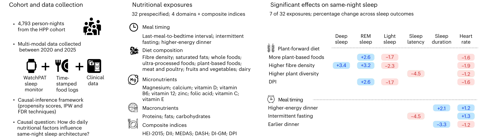

Shkolnik M, Sapir G, Shilo S, Talmor-Barkan Y, Segal E, Rossman H, [*Nature Health*](https://doi.org/10.1038/s44360-026-00182-2)

 

## Paper summary 

Sleep architecture is essential for metabolic and cardiovascular health, yet the impact of day-to-day dietary variation on objective sleep physiology remains unclear. Using an observational causal-inference framework on 4,793 person-nights with real-time dietary logs and multi-stage wearable sleep recordings, we examined how daily nutritional choices relate to that same night’s sleep under free-living conditions, using a lagged-variable design that controls for the preceding day’s dietary and sleep baseline. Causal effects were estimated using inverse probability weighting with bootstrap-based uncertainty quantification. Higher fibre density was associated with increased restorative sleep, including +0.59 percentage points deep sleep (95% confidence interval (CI) = [0.25, 0.94]; P = 0.008), +0.76 percentage points REM sleep (95% CI = [0.21, 1.29]; P = 0.008), −1.35 percentage points light sleep (95% CI = [−2.08, −0.59]; P < 0.01) and −1.14 beats per minute (bpm) mean nocturnal heart rate (95% CI = [−1.67, −0.60]; P < 0.01). Greater plant diversity, defined as the daily count of unique plant-based food items, and higher whole-plant food intake were similarly associated with lower nocturnal heart rate. Meal-timing behaviours primarily influenced sleep duration and autonomic tone. Heavier evening meals, defined by the percentage of total daily energy consumed in the 6 h preceding bedtime, were associated with +7.7 min longer total sleep time (95% CI = [3.71, 12.37]; P < 0.01) and +0.73 bpm higher nocturnal heart rate (95% CI = [0.19, 1.26]; P = 0.032). The Dietary Phytochemical Index was also significantly associated with more restorative sleep-stage composition, including increased REM sleep (+0.62 percentage points; 95% CI = [0.11, 1.19]; P = 0.012), decreased light sleep (−1.00 percentage points; 95% CI = [−1.79, −0.28]; P = 0.006) and lower mean nocturnal heart rate (−0.93 bpm; 95% CI = [−1.48, −0.33]; P = 0.002). In contrast, short-term variation in macronutrient energy distribution and micronutrient consumption showed no robust associations after false discovery rate correction. When our analyses were restricted to more extreme dietary contrasts, the effect magnitudes increased while remaining directionally consistent. These findings indicate that routine daily dietary choices, particularly plant-forward composition and meal timing, have immediate and measurable effects on objective sleep architecture.

 