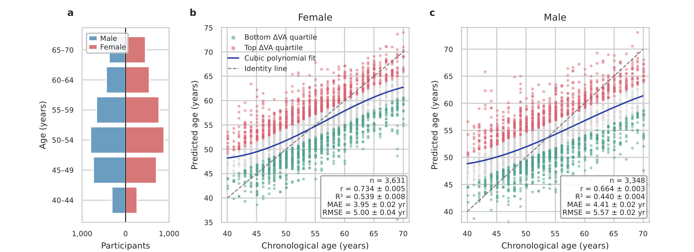

Krongauz D, Marmor Y, Zulti A, Godneva A, Weinberger A, Segal E, [*npj Aging*](https://doi.org/10.1038/s41514-026-00519-x)

 

## Paper summary 

Chronological age does not capture heterogeneity in functional aging, motivating scalable, noninvasive biomarkers. We investigated whether a 30-s voice recording contains a reproducible age-related signal in 6979 Hebrew-speaking Israeli adults aged 40–70 years. Sex-stratified ridge models trained on WavLM-Large speech embeddings predicted chronological age with R² = 53.9% ± 0.8% and MAE = 3.95 ± 0.02 years in females, and R² = 44.0% ± 0.4% and MAE = 4.41 ± 0.02 years in males (mean ± SD across ten independently shuffled participant-level outer partitions). Across modality-specific cohorts, the resulting voice-predicted age, termed Voice Age, showed the second-highest predictive performance among nine single-modality age models and correlated only partially with the other clocks. Adding Voice Age to eight molecular, imaging, physiological, and lifestyle models consistently improved age prediction across sexes and modalities. Combined with mass-spectrometry metabolomics, R² reached 65.1% ± 1.7% in females and 52.2% ± 2.6% in males. Age-residualized Voice Age acceleration was associated in both sexes with adiposity, sleep-disordered breathing, nocturnal oxygenation, and hepatic imaging measures, with additional sex-specific associations involving grip strength and cardiometabolic and skeletal traits. These findings identify voice as an accessible functional aging biomarker that captures information complementary to established biological-age models.

{fig-alt="Figure from the publication: Sound of aging: large-scale evidence for a voice-based biological clock"}