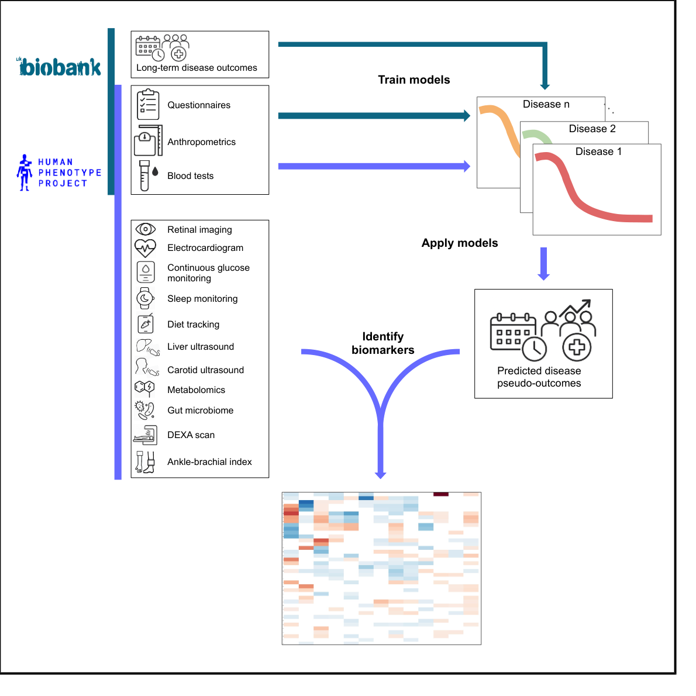

Pellow D, Geva G, Godneva A, Reisner Y, Talmor-Barkan Y, Segal E, [*Med*](https://doi.org/10.1016/j.medj.2025.100993)

 

## Paper summary 

**Background:** We integrate longitudinal health outcomes from the UK Biobank (UKBB) with our own Human Phenotype Project (HPP) cohort. The HPP contains a range of data per participant that are not found in the UKBB, including microbiome, liver ultrasound, continuous glucose monitoring, and more. Conversely, the UKBB includes a much larger cohort and longer follow-up durations with large numbers of disease outcomes already tracked.

**Methods:** To leverage the scale and extended follow-up of the UKBB in our study, we model disease outcomes in the UKBB to predict pseudo-outcomes in the HPP. Correlating these predicted pseudo-outcomes with unique measurements in the HPP study, we identify individual biomarkers for those conditions, including those from gut microbiome, liver ultrasound, and other modalities. Multivariate analysis identifies the contribution of each modality in predicting each pseudo-outcome.

**Findings:** Our method enabled us to recapitulate known biomarkers across the spectrum of diseases studied as well as to reveal less-attested biomarkers in a range of different modalities. We further identify systemic biomarkers correlated with many diseases and sex-specific biomarkers with higher correlation to a pseudo-outcome for one sex as compared to the other.

**Conclusions:** Our method enables analysis of biomarkers leveraging both the scale and follow-up of the UKBB and the unique measurements of the HPP. This analysis provides a broad perspective across the landscape of many diseases through the lens of many modalities, providing a framework for transferring knowledge from large longitudinal cohorts to smaller, more deeply phenotyped cohorts, advancing discovery across modalities.

