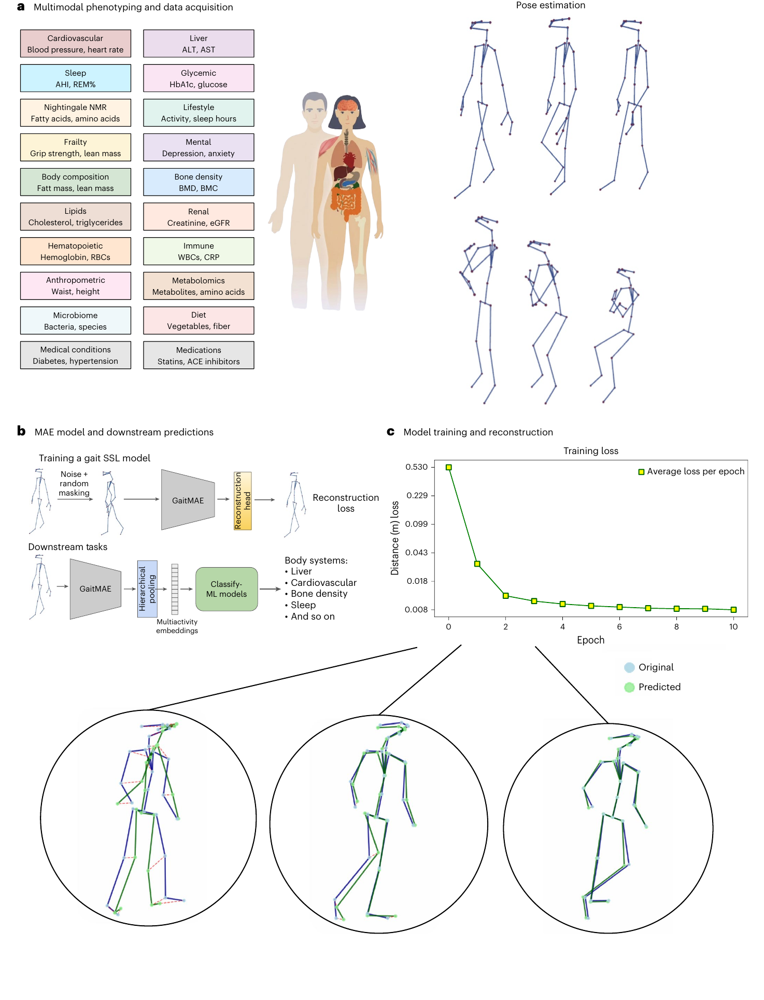

Gabet A, Kohn S, Lutsker G, Gelman S, Godneva A, Sasson G, Zulti A, Krongauz D, Shaulitch R, Rotem A, Doron O, Brodsky Y, Weinberger A, Segal E, [*Nature Medicine*](https://doi.org/10.1038/s41591-026-04724-9)

 

## Paper summary

Gait is increasingly recognized as a vital sign, yet current approaches treat it as a symptom of specific pathologies rather than a systemic biomarker. Here the authors developed a gait foundation model for 3D skeletal motion, recorded via a single-depth camera during 5 motor tasks, from 3,328 deeply phenotyped adults. The purpose was to capture the full pattern of a person’s movement and use it to predict health phenotypes such as grip strength and sleep quality across 18 body systems. Rather than engineered features (e.g. cadence, stride length), the model translates movement into learned embeddings. These embeddings outperformed engineered features for prediction of age (Pearson’s r = 0.69), BMI (r = 0.91) and visceral adipose tissue area (r = 0.83), and significantly predicted 1,887 of 3,210 tested phenotypes. Relative to a baseline using age, BMI, VAT and height alone, gait embeddings improved prediction in all 18 systems in males and 17 of 18 in females, as well as prediction of clinical diagnoses and medication use. Anatomical ablation analyses revealed that leg dynamics dominated metabolic and frailty predictions, and torso dynamics encoded sleep and lifestyle phenotypes. These findings establish gait as an independent, multisystem biosignal, motivating integration of gait analysis into routine clinical assessment as a scalable, passive vital sign.

{fig-alt="Figure from the publication: A gait foundation model for prediction of multisystem health phenotypes from 3D skeletal motion"}